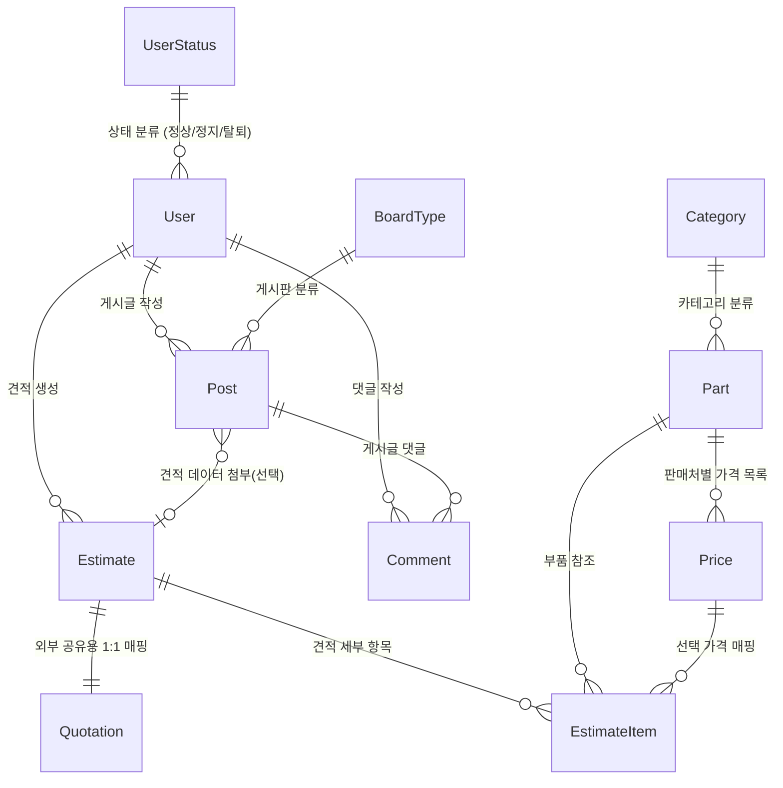

# 💻 PC 부품 가격 비교 & 맞춤 견적 사이트 (`computer-App`)

> **React 19와 Express를 활용하여 만든 실시간 컴퓨터 견적 조립 및 커뮤니티 웹 서비스**  
> 복잡한 하드웨어 부품 정보를 한눈에 비교하고, 실시간으로 견적을 구성하여 안전하게 저장하며, 클릭 한 번으로 다른 사용자들과 견적을 공유하고 소통할 수 있는 풀스택 프로젝트입니다.

<br/>

<div align="center">
  
  
  
  
  
  
  
</div>

---

## 📌 목차
1. [프로젝트 소개 및 교육 과정 배경](#about)
2. [체계적인 SW 개발 프로세스 & 설계 문서화](#documentation)
3. [기술 스택 (Tech Stack)](#tech-stack)
4. [시스템 아키텍처 및 데이터베이스 모델링 (ERD)](#architecture)
5. [핵심 기능 안내 (Key Features)](#features)
6. [기술적 의사결정 및 문제 해결 (Engineering Highlights)](#engineering)
7. [프로젝트 폴더 구조 (Directory Structure)](#structure)
8. [설치 및 실행 방법 (Getting Started)](#getting-started)
9. [프로젝트를 통해 배운 점 및 향후 발전 계획](#retrospective)

---

<a id="about"></a>
## 📖 1. 프로젝트 소개 및 교육 과정 배경

### 🎯 기획 배경
컴퓨터를 직접 맞추려면 CPU, 메인보드, 그래픽카드 등 수많은 부품들의 규격과 쇼핑몰 최저가를 일일이 찾아봐야 하는 번거로움이 있습니다.  
이 프로젝트는 **부품을 한곳에서 쉽게 찾아 담고, 총가격을 실시간으로 확인하며, 내가 짠 견적을 다른 사람에게 쉽게 보여주고 조언을 구할 수 있는 서비스**를 직접 만들어보고자 시작했습니다.

### 🏫 교육 과정 및 이수 배경
- **과정명**: **Webkit640 7기** (2025년 대학·기업 협력형 SW아카데미 사업 풀스택 개발자 양성과정 7기) 개인 프로젝트
- **관련 보도**: [전자신문 - 경북형 SW아카데미 7기 수료 및 성과 기사](https://www.etnews.com/20251209000053)
- **구현 범위 및 플랫폼 현황 (웹앱 기획 ➔ 웹 우선 구현)**: 
  - 본 프로젝트는 초기 기획 단계에서 모바일 웹앱(Web App)을 목표로 고안되었습니다.
  - 다만 교육 과정 중 진행된 **유라클 모피어스(Morpheus) 집체 교육 일정 및 시간 관계상**, 이번 제출 단계에서는 **웹(Web) 환경을 중심으로 핵심 기능(견적 빌더, DB 트랜잭션, 커뮤니티)을 우선 완성하여 제출**하였습니다.
  - 향후 집체 교육에서 이수한 모피어스 하이브리드 앱 기술을 바탕으로 모바일 웹앱 패키징 및 고도화를 진행할 계획입니다.

---

<a id="documentation"></a>
## 📑 2. 체계적인 SW 개발 프로세스 & 설계 문서화

단순히 기능만 빠르게 만드는 코딩이 아니라, 현업 개발 프로세스처럼 **사전 기획과 문서화**(SDLC)를 거친 뒤 개발에 착수했습니다.


### 1) 요구사항 정의서 (Functional Specification)
- 일반 회원과 관리자 회원의 접근 권한 분리.
- 견적 조립기, 부품 카탈로그, 4종 커뮤니티 게시판, 통합 검색 등 필수 기능과 비기능적 요구사항(데이터 무결성, 반응형 화면)을 사전에 정의.

### 2) UI/UX 화면 설계서 및 와이어프레임
- 부품 목록 검색 ➔ 부품 선택 모달 ➔ 실시간 합계 확인 ➔ 내 견적 저장 ➔ 게시글 공유로 이어지는 사용자 동선을 기획.
- PC와 모바일 화면 모두에서 깨지지 않도록 Bootstrap 그리드 기반의 반응형 화면을 설계.

### 3) 데이터베이스 설계서 (ERD & 정규화)
- 부품, 가격, 사용자, 견적서, 게시판 간의 관계를 1차~3차 정규화 원칙에 맞추어 설계.
- 부품 가격이 달라져도 기존 견적서 내역이 망가지지 않도록 중간 테이블(`EstimateItem`) 구조를 수립.

### 4) RESTful API 명세서
- URI 주소만 보고도 어떤 자원인지 알 수 있도록 직관적인 REST API 엔드포인트 설계.
- 성공(`200`, `201`), 클라이언트 에러(`400`, `401`, `403`, `404`), 서버 에러(`500`) 등 표준 HTTP 상태 코드와 응답 메시지를 규격화.

---

<a id="tech-stack"></a>
## 🛠️ 3. 기술 스택 (Tech Stack)

### Frontend
| 기술 | 버전 | 선정이유 및 역할 |
| :--- | :--- | :--- |
| **React** | `19.1.1` | 최신 리액트의 컴포넌트 기반 아키텍처로 UI 재사용성 및 렌더링 효율 확보 |
| **Vite** | `7.1.7` | 빠른 빌드 속도와 HMR(Hot Module Replacement)로 쾌적한 개발 환경 구축 |
| **React Router** | `7.9.4` | SPA(단일 페이지 앱) 환경에서 자연스러운 화면 전환 및 관리자 라우트 가드 구현 |
| **Bootstrap** | `5.3.8` | 반응형 레이아웃 구현 및 다크모드/라이트모드 스타일 토글 적용 |
| **Context API** | - | 로그인 정보(`AuthContext`)를 전역에서 안전하게 공유 |
| **Custom Hooks** | - | 10개의 커스텀 훅을 제작하여 컴포넌트에서 데이터 통신 로직을 깔끔하게 분리 |

### Backend
| 기술 | 버전 | 선정이유 및 역할 |
| :--- | :--- | :--- |
| **Node.js / Express** | Express `5.1.0` | 가볍고 빠른 비동기 I/O를 바탕으로 RESTful API 서버 구축 |
| **Sequelize** | `6.37.7` | 객체 기반으로 MySQL 데이터를 다루며, DB 트랜잭션으로 데이터 무결성 보장 |
| **MySQL** | `8.0` | 부품과 견적, 유저 간의 관계를 체계적으로 관리하는 RDBMS |
| **JWT / bcryptjs** | `9.0.2` / `3.0.2` | 안전한 비밀번호 단방향 암호화 및 토큰 기반 로그인 인증 처리 |
| **Puppeteer / Cheerio** | `24.25.0` | 다나와 등 외부 사이트의 하드웨어 부품 데이터 수집 및 자동 DB 시딩 |

---

<a id="architecture"></a>
## 🏛️ 4. 시스템 아키텍처 및 데이터베이스 모델링 (ERD)

데이터가 중복되거나 누락되지 않도록 10개의 테이블을 관계형 구조로 정규화했습니다.



### 📌 데이터베이스 설계 핵심
1. **견적 세부 항목 분리 (`Estimate` ↔ `EstimateItem`)**:
   - 한 견적에 여러 부품이 들어가므로 N:M 관계를 해소하기 위해 `EstimateItem` 테이블을 두고, 부품 ID, 당시 가격 ID, 수량을 명확하게 묶어 저장했습니다.
2. **공유용 고유 엔티티 분리 (`Quotation`)**:
   - 개인 견적서 ID를 그대로 외부에 노출하지 않고, 공개 전용 고유 키를 가진 `Quotation`을 1:1로 두어 안전하게 공유 링크를 만들 수 있게 설계했습니다.
3. **게시판과 견적 데이터 연결 (`Post.estimateId`)**:
   - 게시글을 작성할 때 내가 만든 견적을 바로 첨부할 수 있도록 외래키를 연결했습니다.
4. **회원 탈퇴 시 데이터 보존 (`UserStatus`)**:
   - 회원이 탈퇴할 때 작성 글이나 댓글이 꼬이지 않도록, 데이터를 물리적으로 지우지 않고 상태값만 '탈퇴'로 바꾸는 **소프트 딜리트(Soft Delete)** 방식을 적용했습니다.

---

<a id="features"></a>
## 🚀 5. 핵심 기능 안내 (Key Features)

### 1. 실시간 PC 부품 조립 및 견적 계산기 (Quote Builder)
- **슬롯별 부품 선택**: CPU, 메인보드, 메모리, 그래픽카드, SSD, 케이스, 파워 등 카테고리별로 모달 창에서 원하는 부품을 바로 선택.
- **실시간 총액 자동 계산**: 부품을 추가하거나 수량을 바꿀 때마다 리액트의 `useMemo`를 통해 합계 금액이 버벅임 없이 즉시 반영.
- **불러오기 기능**: 마이페이지에 저장해 둔 예전 견적서를 다시 가져와서 부품을 바꾸거나 수정 가능.

### 2. 간편한 견적 공유 & 커뮤니티 자동 등록
- **공유 링크 복사**: 로그인하지 않은 사람도 볼 수 있는 고유 링크(`origin/quote/:id`)를 원클릭으로 클립보드에 복사.
- **게시글 내용 자동 완성**: 마이페이지에서 '공유' 버튼을 누르면 부품명, 가격, 수량, 총금액이 보기 좋은 텍스트로 자동 서식화되어 **견적 공유 게시판** 작성 화면으로 바로 이동.

### 3. 부품·게시글·댓글 한 번에 찾는 통합 검색
- 부품 이름뿐만 아니라 커뮤니티 게시글과 댓글까지 한 번의 검색으로 모두 탐색.
- 부품 카테고리 선택, 가격대(최저~최고가) 범위 지정, 게시글(제목/본문/작성자) 상세 검색 옵션 제공.

### 4. 4종 커뮤니티 게시판
- **게시판 분류**: 견적 공유, 질문 게시판, 자유 게시판, 핫딜 게시판.
- **조회수 및 댓글 기능**: 게시글 열람 시 조회수 증가, 자유로운 댓글 작성 및 인라인 수정/삭제.
- **홈 화면 최신글 모아보기**: 메인 페이지에서 각 게시판의 최신 글 3개씩을 실시간으로 확인.

### 5. 회원 관리 및 관리자 페이지
- JWT 기반 로그인/로그아웃 및 내 정보 관리(닉네임 변경, 비밀번호 변경, 탈퇴).
- 관리자 계정(`admin`) 전용 대시보드: 회원 상태 변경(정지/해제), 신규 부품 등록/수정/삭제, 카테고리 및 게시판 추가/관리.

---

<a id="engineering"></a>
## 💡 6. 기술적 의사결정 및 문제 해결 (Engineering Highlights)

> 💡 **6가지 핵심 질문과 개발자의 해결 과정**을 정리했습니다.

---

### Q1. 견적서를 저장할 때 여러 테이블에 데이터가 들어가는데, 중간에 실패하면 데이터가 꼬이지 않나요?
> **A. DB 트랜잭션(ACID)을 적용하여 '전부 저장되거나, 아니면 아예 취소되도록' 안전하게 처리했습니다.**

- **상황**: 견적을 저장하려면 ① 견적 기본 정보(`Estimate`) ➜ ② 담긴 부품들과 수량(`EstimateItem`) ➜ ③ 외부 공유용 정보(`Quotation`)까지 3번의 DB 저장이 연속으로 일어나야 합니다.
- **문제점**: 2번째 부품 목록을 넣다가 DB 연결이 끊어지면, 견적서 껍데기만 남고 부품은 없는 쓰레기 데이터(Orphan record)가 남게 됩니다.
- **해결책**:
  ```javascript
  // backend/controllers/estimateController.js
  const result = await db.sequelize.transaction(async (t) => {
      // 1. 견적 기본 정보 생성
      const newEstimate = await Estimate.create({ name, userId }, { transaction: t });

      // 2. 담긴 부품 항목들을 bulkCreate로 한 번에 생성
      const estimateItemsData = req.body.items.map(item => ({
          estimateId: newEstimate.id,
          partId: item.part.id,
          priceId: item.part.Prices[0].id,
          quantity: item.quantity,
      }));
      const newEstimateItems = await EstimateItem.bulkCreate(estimateItemsData, { transaction: t });

      // 3. 외부 공유용 고유 레코드 생성
      await Quotation.create({
          estimateId: newEstimate.id,
          estimateItemId: newEstimateItems[0].id
      }, { transaction: t });

      return newEstimate;
  });
  ```
  `sequelize.transaction`으로 세 단계를 하나의 작업 단위로 묶었습니다. 어느 하나라도 에러가 나면 이전 작업들이 자동으로 롤백(Rollback)되어 DB가 항상 깨끗하고 일관성 있게 유지됩니다.

---

### Q2. 견적 페이지에서 부품을 바꾸거나 수량을 조절할 때 화면 렌더링이 버벅이지 않나요?
> **A. 상태 구조를 카테고리별 객체 맵으로 관리하고, `useMemo`를 활용해 계산 비용을 최소화했습니다.**

- **상황**: 사용자가 부품을 고르거나 수량을 `+`, `-` 버튼으로 바꿀 때마다 전체 견적 총액이 즉시 다시 계산되어야 합니다.
- **문제점**: 배열 전체를 순회하면서 불필요한 컴포넌트까지 전부 다시 렌더링되면 수량 버튼을 누를 때 딜레이가 발생할 수 있습니다.
- **해결책**:
  ```javascript
  // frontend/src/pages/QuoteBuilderPage.jsx
  // 1. 카테고리 슬러그를 key로 하여 선택된 부품을 O(1)로 빠르게 조회/수정
  const [selectedParts, setSelectedParts] = useState({});

  // 2. selectedParts 상태가 바뀔 때만 총액을 다시 계산
  const totalPrice = useMemo(() => {
      return Object.values(selectedParts).reduce((sum, item) => {
          const price = item.part.Prices?.[0]?.price || 0;
          return sum + (price * item.quantity);
      }, 0);
  }, [selectedParts]);
  ```
  선택된 부품 목록(`selectedParts`)이 변경되었을 때만 총금액을 계산하도록 메모이제이션(`useMemo`)을 적용하여 렌더링 성능을 최적화했습니다.

---

### Q3. 컴포넌트 안에 API 통신 코드와 상태 관리가 뒤섞여 코드가 길어지는 문제는 어떻게 해결했나요?
> **A. 10개의 커스텀 훅(Custom Hook)을 만들어 비즈니스 로직과 화면 UI를 깔끔하게 분리했습니다.**

- **문제점**: 페이지 컴포넌트마다 `axios.get`, `loading`, `error` 처리 코드를 반복해서 작성하면 코드가 300~400줄씩 늘어나고 유지보수가 어려워집니다.
- **해결책**:
  역할별로 **10개의 커스텀 훅**을 만들어 데이터 페칭과 비즈니스 로직을 완전히 캡슐화했습니다:
  - 부품 관련: `useParts`, `usePartDetail`, `useCategories`
  - 견적 관련: `useMyEstimates`, `usePublicQuote`
  - 커뮤니티 관련: `useBoardTypes`, `usePosts`, `usePostDetail`
  - 공통/유틸: `useSearch`, `useTheme`
  ```javascript
  // 컴포넌트에서는 단 한 줄로 깔끔하게 데이터와 상태를 가져와 사용
  const { parts, loading, error } = useParts(categorySlug);
  const { estimates, deleteEstimate } = useMyEstimates(token);
  ```
  컴포넌트는 오직 '화면에 어떻게 보여줄지(UI)'에만 집중할 수 있게 되어 코드 가독성과 재사용성이 크게 향상되었습니다.

---

### Q4. 부품, 게시글, 댓글을 한 번에 찾는 통합 검색에서 속도가 느려지지 않나요?
> **A. `Promise.all`을 사용하여 세 개의 DB 검색을 동시에 병렬로 실행했습니다.**

- **문제점**: 부품 찾기 ➜ 게시글 찾기 ➜ 댓글 찾기를 순서대로 하나씩 실행하면 대기 시간이 3배로 늘어납니다.
- **해결책**:
  ```javascript
  // backend/controllers/searchController.js
  const [partResults, postResults, commentResults] = await Promise.all([
      Part.findAll({ where: partWhere, include: [Category, { model: Price, where: priceWhere }] }),
      Post.findAll({ where: postWhere, include: [{ model: User, attributes: ['nickname'] }] }),
      Comment.findAll({ where: { content: { [Op.like]: `%${q}%` } }, include: [User, Post] })
  ]);
  ```
  서로 관련 없는 3개의 검색 쿼리를 비동기 병렬 처리(`Promise.all`)하여 응답 시간을 1회 쿼리 수준으로 단축했습니다.

---

### Q5. 외부에서 수집한 부품 스펙 텍스트가 제각각인데, 어떻게 규격화해서 저장했나요?
> **A. 정규식 기반의 문자열 파싱 헬퍼 함수(`parseSpec`)를 만들어 구조화된 JSON 데이터로 변환했습니다.**

- **문제점**: 부품 스펙 정보가 `"AMD(소켓AM5) 8코어 16스레드 DDR5 5nm 기본 클럭:4.2GHz TDP:120W"`처럼 긴 한 줄의 텍스트로 들어와서, 특정 스펙(소켓, 코어 수 등)만 따로 비교하기가 어려웠습니다.
- **해결책**:
  ```javascript
  // backend/seed.js
  const parseSpec = (specText) => {
      const spec = {};
      if (!specText) return spec;
      const keywords = ['코어', '스레드', '클럭', '소켓', 'DDR', 'TDP', 'VGA 길이', 'M.2', 'PCIe'];
      const items = specText.split(/[\s,]+/);

      items.forEach(item => {
          for (const keyword of keywords) {
              if (item.includes(keyword) && !spec[keyword]) {
                  spec[keyword] = item;
              }
          }
      });
      return spec;
  };
  ```
  핵심 키워드를 기준으로 텍스트를 자동 파싱하여 DB에 `{ "소켓": "AMD(소켓AM5)", "코어": "8코어", "TDP": "120W" }` 형태의 정형 JSON으로 저장되도록 전처리 파이프라인을 구축했습니다.

---

### Q6. 사용자가 짠 견적을 커뮤니티에 공유할 때의 사용자 경험(UX)은 어떻게 개선했나요?
> **A. 사용자가 일일이 복사해서 적을 필요 없이, '공유' 버튼 클릭 한 번으로 글 본문이 자동 작성되도록 구현했습니다.**

- **문제점**: 견적을 자랑하거나 조언을 구하려면 부품 이름과 가격을 메모장에 적어두고 게시판에 수기로 다시 타이핑해야 해서 사용자 이탈이 발생할 수 있습니다.
- **해결책**:
  마이페이지에서 [공유] 버튼을 누르면 견적 데이터를 읽어 `generateQuoteText()` 함수가 아래처럼 줄바꿈된 서식 텍스트를 자동 생성합니다:
  ```text
  부품명, 가격, 수량
  AMD 라이젠7-5세대 7800X3D, 502,010원, 1개
  MSI MAG B850M 박격포 WIFI, 275,250원, 1개
  -----
  총 가격 : 777,260원
  ```
  그리고 글쓰기 페이지로 이동하면서 **게시판 종류는 '견적 공유'로 자동 지정**되고 본문에 위 내용이 즉시 채워지도록 사용자 동선을 자동화했습니다.

---

<a id="structure"></a>
## 📂 7. 프로젝트 폴더 구조 (Directory Structure)

```
computer-App/
├── README.md                               # 프로젝트 종합 문서
│
├── backend/                                # Node.js + Express REST API 서버
│   ├── app.js                              # Express 진입점 및 라우트 연결
│   ├── seed.js                             # 초기 데이터(카테고리, 부품, 가격, 계정) 시딩 및 스펙 파서
│   ├── config/config.json                  # MySQL 연결 설정 (dev / test / prod)
│   ├── middleware/authMiddleware.js        # JWT 로그인 검증 및 관리자 권한 체크 미들웨어
│   ├── models/                             # Sequelize 모델 정의 (10개)
│   │   ├── index.js                        # 모델 관계(Association) 로더
│   │   ├── user.js / userStatus.js         # 회원 및 회원상태(정상/정지/탈퇴)
│   │   ├── category.js / part.js / price.js # 카테고리, 부품, 판매처 최저가
│   │   ├── estimate.js / estimateItem.js   # 견적서 및 견적에 담긴 부품들
│   │   ├── quotation.js                    # 공개용 공유 견적
│   │   └── boardType.js / post.js / comment.js # 게시판 종류, 게시글, 댓글
│   ├── routes/                             # API 라우트 파일들 (10개)
│   └── controllers/                        # DB 쿼리 및 비즈니스 로직 (10개)
│
└── frontend/                               # React 19 + Vite 클라이언트
    ├── vite.config.js
    └── src/
        ├── main.jsx / App.jsx              # 앱 시작점, 라우트 설정, 테마 적용
        ├── index.css                       # 다크/라이트 모드 스타일
        ├── context/AuthContext.jsx         # 전역 로그인 상태 관리
        ├── hooks/                          # 비즈니스 로직 분리 커스텀 훅 (10개)
        │   ├── useTheme.js                 # 다크모드 토글 및 localStorage 저장
        │   ├── useCategories.js / useParts.js / usePartDetail.js # 부품 조회
        │   ├── useMyEstimates.js / usePublicQuote.js             # 견적 조회/삭제/공유
        │   ├── useBoardTypes.js / usePosts.js / usePostDetail.js # 게시판/게시글/댓글
        │   └── useSearch.js                # 통합 검색
        ├── components/                     # 재사용 UI 컴포넌트
        │   ├── layout/ (Header, Footer)    # 상단 메뉴바, 검색창, 테마 토글 버튼
        │   ├── common/ (AdminRoute.jsx)    # 관리자 전용 페이지 접근 가드
        │   └── quote/ (PartSelectionModal) # 견적용 부품 선택 모달
        └── pages/                          # 화면 페이지 (13개)
            ├── HomePage.jsx / LoginPage.jsx / RegisterPage.jsx
            ├── PartListPage.jsx / PartDetailPage.jsx  # 부품 목록 및 상세정보
            ├── QuoteBuilderPage.jsx                   # 견적 조립기 (핵심 기능)
            ├── SharedQuotePage.jsx                    # 공유 링크 견적 조회 화면
            ├── MyPage.jsx                             # 내 견적/글/댓글 관리
            ├── CommunityPage.jsx / PostDetailPage.jsx / CreatePostPage.jsx
            ├── SearchResultsPage.jsx                  # 검색 결과 화면
            └── AdminPage.jsx / EditPartPage.jsx       # 관리자 전용 대시보드
```

---

<a id="getting-started"></a>
## 💻 8. 설치 및 실행 방법 (Getting Started)

### 사전 준비 (Prerequisites)
- [Node.js](https://nodejs.org/) (v18.0.0 이상 권장)
- [MySQL Server](https://www.mysql.com/) (v8.0 이상)

### 1) 프로젝트 복사 (Clone)
```bash
git clone https://github.com/your-username/computer-App.git
cd computer-App
```

### 2) 백엔드 실행
```bash
cd backend
npm install

# backend/config/config.json 파일에서 본인의 MySQL 비밀번호 설정 확인
# MySQL에 computer_app_db 데이터베이스를 생성한 후 서버 시작:
npm run dev
# -> 서버가 켜질 때 seed.js가 자동으로 실행되어 초기 부품, 카테고리, 테스트 계정이 생성됩니다.
# (Server running on http://localhost:5000)
```

### 3) 프론트엔드 실행
```bash
cd ../frontend
npm install
npm run dev
# (Vite 개발 서버 running on http://localhost:5173)
```

### 4) 테스트용 기본 계정
- **일반 사용자 계정**: 아이디 `1234` / 비밀번호 `1234pw` (닉네임: `일반회원`)
- **관리자 계정**: 아이디 `admintest` / 비밀번호 `1234pw` (닉네임: `관리자`, 상단 메뉴에 관리자 페이지 노출)

---

<a id="retrospective"></a>
## 📈 9. 프로젝트를 통해 배운 점 및 향후 발전 계획

### 🎯 배운 점
1. **설계 문서의 힘**: 무작정 코딩을 시작하기보다 요구사항 정의서, 와이어프레임, ERD, API 명세서를 먼저 정리하고 개발하니 중간에 구조를 뒤엎는 시행착오를 크게 줄일 수 있었습니다.
2. **데이터 무결성의 가치**: 견적서 저장 로직에 트랜잭션을 적용해보면서, 네트워크 불안정이나 서버 에러 상황에서도 데이터가 오염되지 않도록 방어하는 백엔드 개발자의 책임을 배웠습니다.
3. **가독성 높은 리액트 코드**: 10개의 커스텀 훅으로 API 호출 로직을 분리해내면서 화면 컴포넌트 코드가 훨씬 깔끔해지고 유지보수가 쉬워지는 경험을 했습니다.

### 🔮 향후 발전 계획 (Next Step)
- [ ] **모바일 하이브리드 앱 패키징**: 교육 과정에서 배운 유라클 모피어스(Morpheus) 솔루션을 활용하여 스마트폰 앱으로 패키징 및 푸시 알림 기능 추가.
- [ ] **부품 호환성 자동 체크 기능**: CPU 소켓과 메인보드가 맞지 않거나, 그래픽카드 권장 파워보다 파워서플라이 출력이 낮을 경우 경고 메시지를 띄워주는 로직 개발.
- [ ] **최저가 자동 갱신 스케줄러**: 정해진 시간마다 다나와 최저가를 크롤링하여 DB 가격을 최신으로 업데이트하는 Cron 스케줄러 구축.
